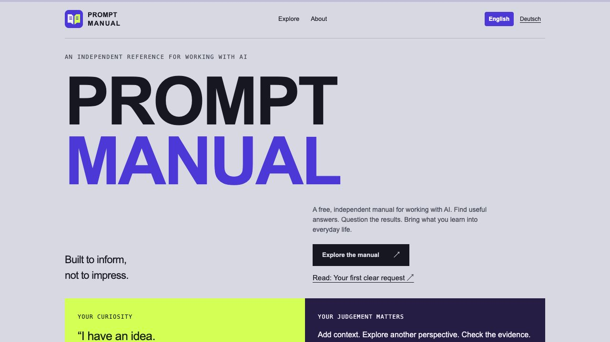
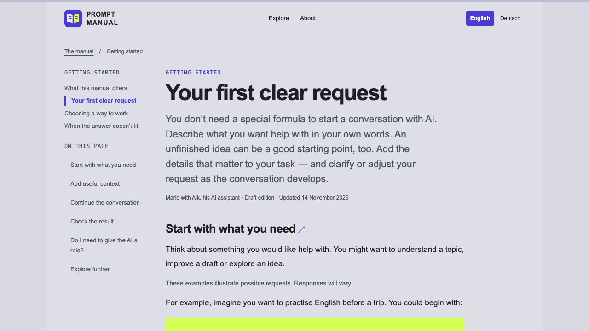

# PROMPT MANUAL
**Built to inform, not to impress.**

PROMPT MANUAL is a free, independent, privately maintained reference for communicating and working with AI.

It is not a course. Readers can start with their own questions, explore practical examples, and return whenever they need guidance.

The project is created by Mario V.W.B.R. Obst with Aik, his AI assistant. Mario brings ideas, experience, and judgement, checks the results, and takes responsibility for what is published. Developing the manual is also a way for him to learn through doing.

Privacy by Design guides the website: images and styling are served locally, and optional analytics are not used.

This repository documents selected project decisions, design development, and progress. Some published pages retain dated draft labels as the manual continues to develop.

**Read the manual:** [English](https://prompt-manual.fyi/) · [Deutsch](https://prompt-manual.fyi/de/)

**Meet us:** [Mario & Aik](https://prompt-manual.fyi/mario-and-aik/)

## Explore this repository

- [Design and editorial decisions](DESIGN.md)
- [Current status and next steps](ROADMAP.md)

## Website views

The published homepage and a reading page, captured on 14 November 2026.

## Scope

This is a selected public project record. The website source code, working files, full conversations, unpublished drafts, visitor correspondence, and account information are not included.

## Feedback

Questions and suggestions are welcome at [prompt.manual@marioobst.com](mailto:prompt.manual@marioobst.com).
